<div align="center">


# SAYONARA EMPIRE


**A giant Indian economy & business-tycoon simulator that runs entirely in your browser.**
Start with a single chai stall in Uttam Nagar, Delhi — end with businesses across **399 cities in 51+ countries**, AI managers running your operations, imports docking from Dubai and Shanghai, and a legacy the whole world reads about in the *Sheher Times*.

[](https://pranshu198.github.io/sayonara-empire/)


</div>

---

## Screenshots (real, from the live build)

| The app on desktop — device frame | The app on phone — swipe tabs, pill nav |
|---|---|
| 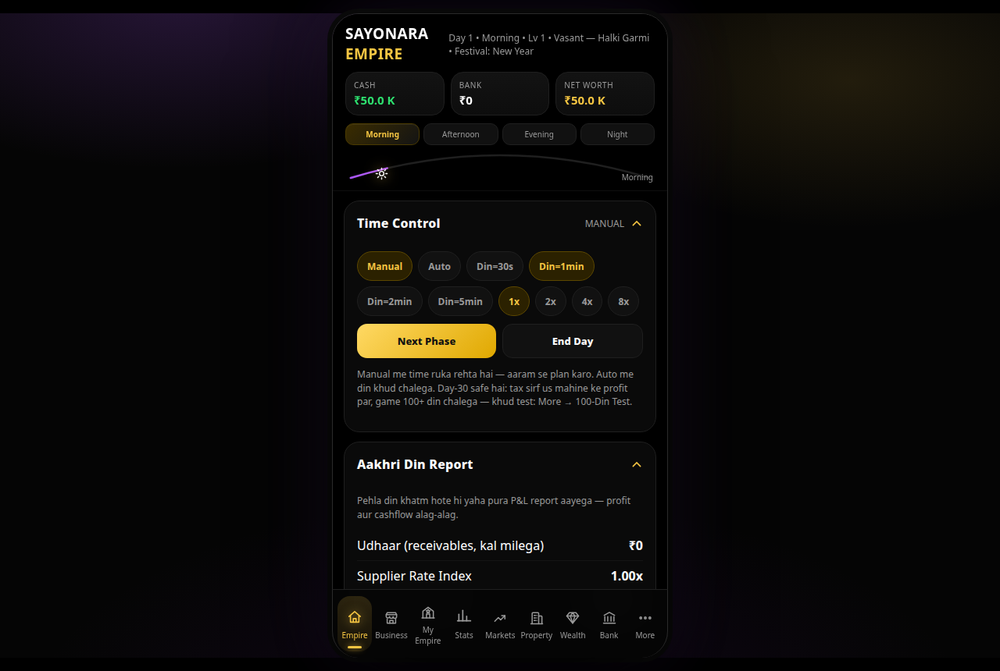 | 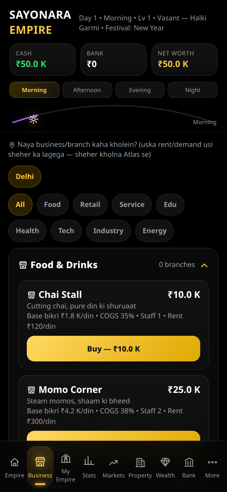 |

| Splash | Dashboard — Day 47 | Businesses & Procurement |
|---|---|---|
| 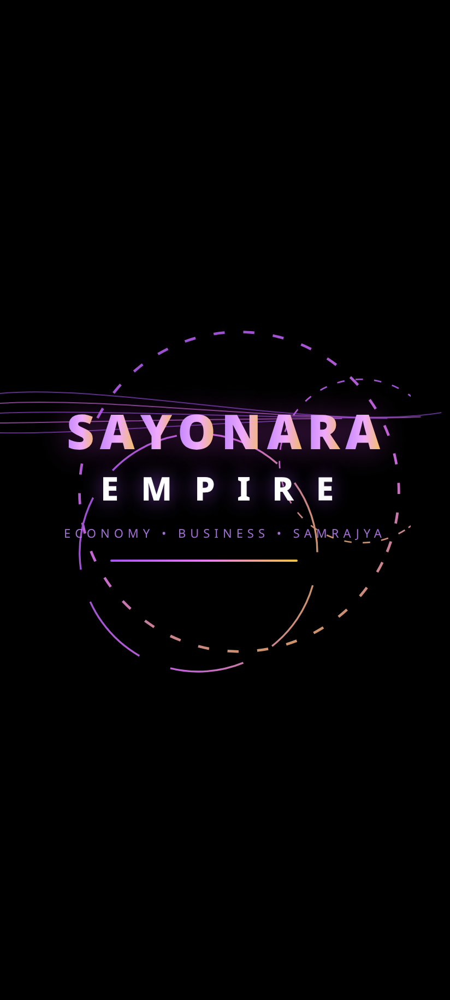 |  | 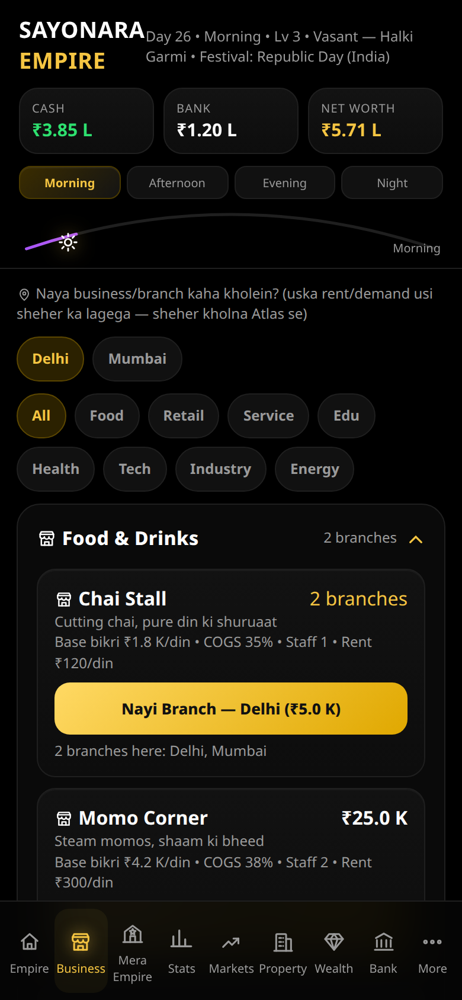 |

| Markets + per-stock news | Wealth Empire | World Atlas — Gujarat |
|---|---|---|
| 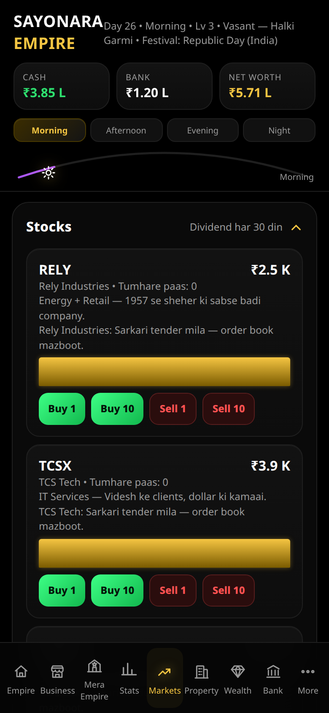 | 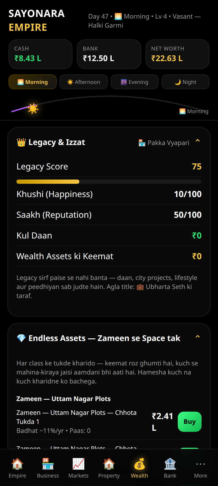 | 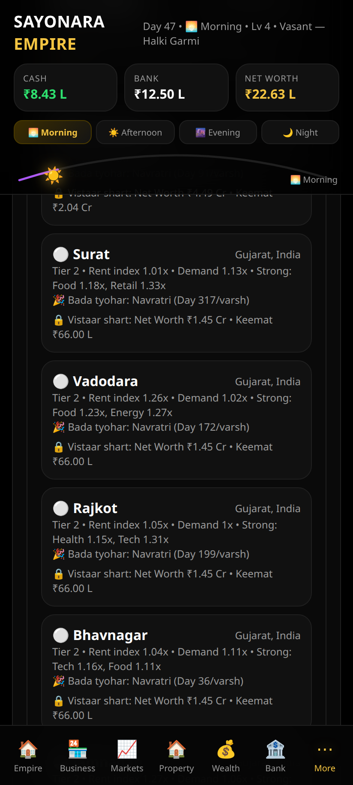 |

| Stats / Analytics — live rates, lifetime, records |
|---|
| 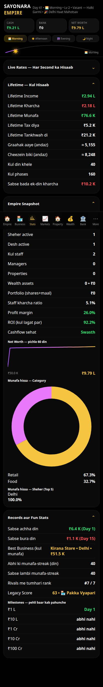 |

| My Empire HQ — brand rollup, branches | HQ Detail — per-branch P&L & control | Staff — CV Team (hire/train/promote) |
|---|---|---|
| 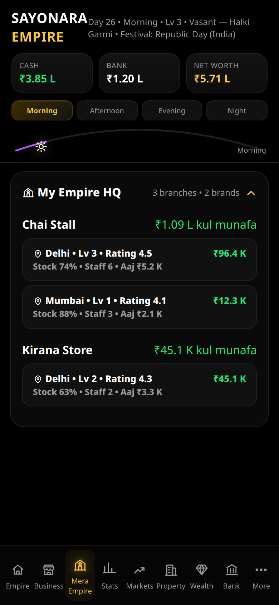 | 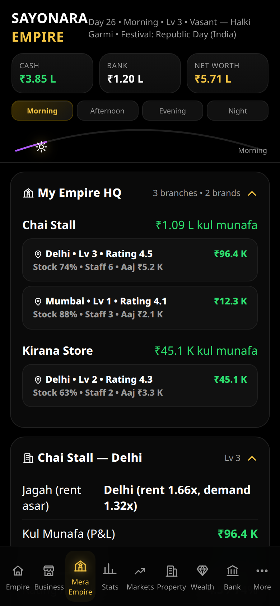 | 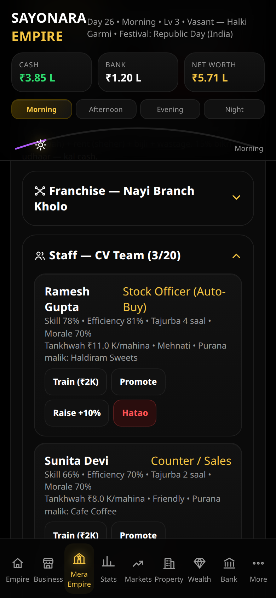 |

| UI in Hindi (Devanagari) | UI in Urdu (Roman) | UI in Arabic (RTL) |
|---|---|---|
|  | 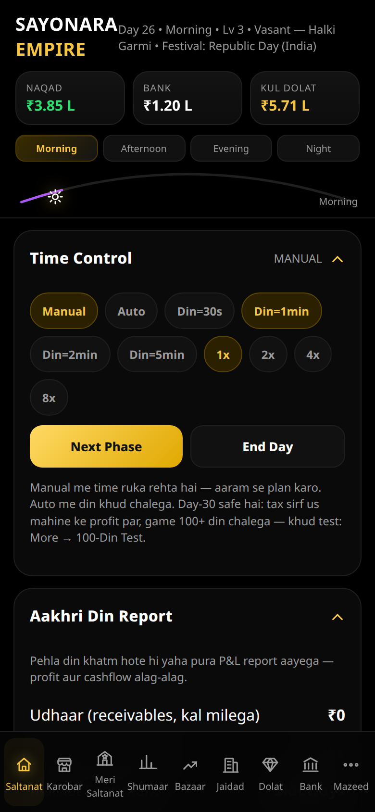 | 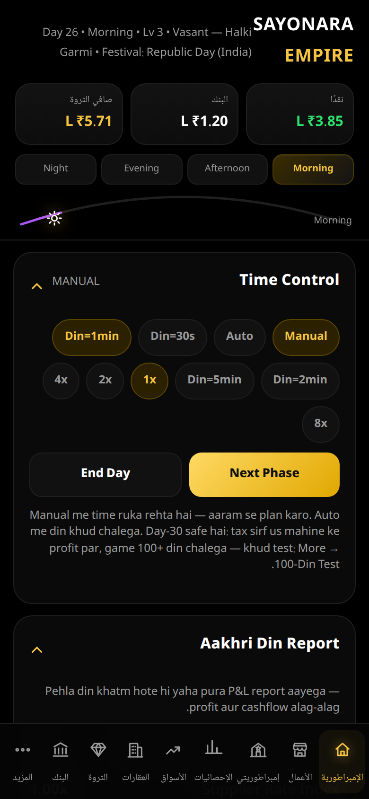 |

---

## What is this?

Sayonara Empire is a **deep economy simulation game** built by a solo indie developer from Delhi, India — designed phone-first, in a pure AMOLED-black UI, with a Hinglish heart and a real accounting soul.

This is not a clicker. Every business runs on a **line-by-line Profit & Loss engine**: footfall × conversion × price on the revenue side; supplier COGS, wages with PF/ESI, rising rent, utilities, wastage and depreciation on the cost side. **Profit is not cashflow** — 15% of sales arrive as receivables the next day, loans take EMI, and tax is charged **only on that month's accumulated profit** at every guarded month-end (the famous "Day-30 freeze" of v1 is fixed by design and covered by an in-game 100-Day Test).

## The world is the board

- **World Atlas — 399 cities.** All 28 Indian states + 8 UTs (187 Indian cities, with districts for the big metros) and 212 world cities across 51+ countries — New York, London, Dubai, Singapore, Tokyo, Sydney, Toronto… Every city has a population tier, rent index, demand index, category strengths, climate flavour and a signature festival. Expand city-by-city (cost + net-worth gate), open businesses *there*, and watch that city's rent and demand flow straight into your P&L.
- **306 real festivals.** Diwali, Holi, Eid (×2), Pongal, Onam, Durga Puja, Ganesh Chaturthi, Chhath, Bihu, Rath Yatra — plus Chinese New Year, Halloween, Thanksgiving, Black Friday, Oktoberfest, Rio Carnival, Singles' Day and independence days. Festivals boost matching categories **only where you operate**, trigger corporate hamper orders, send staff on leave, print headlines, and show up on a 30-day lookahead calendar so you can stock up in time.
- **Procurement engine — 340 items.** Every input has several sellers side-by-side (local mandi, national distributor, company direct) differing in quality tier (Local / Economy / Premium / Branded), unit price, bulk slabs, delivery days, reliability % and payment terms. Your chosen contract changes COGS, wastage, complaint risk and your **price ceiling** in the live P&L.
- **Import system — 1,500 listings.** Buy from Atlas countries with the full landed cost shown *before* you confirm: base price × live FX + shipping + customs duty − container discount. Stock arrives days later (port delays happen), and earns the business a 14-day **"Imported" tag** that lifts demand.
- **AI Managers — 640 profiles, 8 roles.** Hire Purchase, Inventory, Pricing, Marketing, Finance, HR, Trading and Expansion managers. Set their rules (restock below X%, auto-sell at +Y%, keep cash above Z); they act every phase and **log every action** in an auditable Manager Activity Report. High skill = fewer mistakes. A bad manager *will* lose you money — and the report will honestly say so.
- **Stats / Analytics command center.** A dedicated tab (own SVG icon) with live rate meters — income/sec, burn/sec and net/sec derived honestly from the engine's actual recent P&L (in Manual mode they switch to per-phase units), a burn breakdown by wages/rent/COGS/utilities/wastage/interest, lifetime counters (income, expenses, taxes paid, wages paid, estimated customers & items, best/worst day, biggest expense day), an empire snapshot (branches, cities, countries, staff, portfolio, net-worth chart, profit-share donut by category, top-5 cities), and records — milestone days for ₹1L/₹10L/₹1Cr+, profit streaks, rival rank and Legacy score. Lifetime counters are persisted in the save and, on older saves, honestly start counting from the day the feature arrived.

## Pass 3.2 — HQ, people, languages & polish

- **My Empire HQ (new tab).** Only *your* running businesses live here — grouped by brand with a profit rollup, every branch as its own card (city, level, rating, stock, staff, today's profit). Open a branch for its full HQ detail: P&L rows, price slider, restock/upgrade/marketing/sell, its own procurement contracts, franchise expansion, staff and auto-buy rules.
- **Franchise — true multi-location.** The same brand can run in many Atlas cities at once (each branch = its own staff, stock, P&L and city rent/demand; setup cost 50% of the business price, no branch limit but your cash). Old saves migrate automatically: every existing business becomes a branch in its city.
- **Deep staff with CVs.** Per-branch hiring from a 4,200-profile candidate library. Every CV shows name, role, skill %, efficiency %, experience, expected salary, trait and past employer — hire (25% signing), train, promote, raise or fire. Staff are real in the engine: their wages are a P&L cost line and their average quality moves revenue (capacity scales with level — a Lv 3 stall seats 20).
- **Auto-Stock Officer + HR Manager.** A Stock Officer hired *inside* a branch auto-buys its material by your rules (target stock %, max unit price, seller preference, imports allowed) and logs every purchase. The HR Manager improves the candidate pool, value-sorts the CV shortlist, can auto-hire under a salary cap, and runs morale + Day-30 appraisals.
- **Zero emojis — own icon library.** Every icon in the app is a hand-built stroke SVG from the in-house set (`src/components/icons/`, ~48 icons); generated text is sanitised before display. Grep-verified: **zero emoji characters in the entire `src/` tree**.
- **19 languages.** A real `t(key)` i18n system (`src/i18n/`, one lazy file per language): English, Hindi (Devanagari), Hinglish, **Urdu (Roman)** — Hinglish-style, Urdu script, Arabic (full RTL layout), French, Russian, Spanish, Portuguese, German, Bengali, Punjabi, Marathi, Tamil, Telugu, Chinese, Japanese, Korean. Searchable picker in Settings, browser auto-detect, instant switch, per-script fonts. Menus/labels/buttons/time/stats fully translate; the deep story/news libraries stay in their original language (stated honestly in Settings → About).
- **Card design system + ultra polish.** One card family (Base/Stat/Business/Asset/Person/Listing/Metric) with a shared anatomy — icon slot, title, subtitle, value zone, trend chip, action row — in flat/elevated/glass/glow/danger/success variants, an 8-pt spacing rhythm, radius scale 16/20/24, tabular numbers, skeleton shimmer for lazy panels, designed empty states and card-style toasts across every tab.
- **Heavy optimization, same quality.** Initial JS is **304 KB gzip total** (index + vendor + shared engine chunks, 197 chunks overall — Pass 3.4) after slimming the always-loaded content base pools and streaming the rest behind the splash via the deep loader; saves are debounce-throttled (1.5 s + flush on hide/close) instead of a full stringify per change; the Atlas windows long lists (40/page); a Performance Mode (Settings → Advanced, auto by FPS) trims particles on weak devices *without touching the design*. Engine perf, simulated in Node with a 54-branch / 216-staff empire: **1.1 ms per phase** (400 phases, zero errors). Headless verification of the final build: **all 9 tabs + HQ + CV + 5 language UIs — zero console errors, zero horizontal overflow at 390 px.**

## Content depth (all real, all wired into the game)

| Library | Entries | Library | Entries |
|---|---:|---|---:|
| Random events | 6,600 | Customer stories | 8,100 |
| Newspaper headlines | 6,000 | Decision cards | 2,480 |
| Products | 5,760 | Staff pool | 4,200 |
| Missions | 1,982 | Collectibles | 1,950 |
| Angel startups | 1,800 | Movie studio slate | 1,500 |
| Import listings | 1,500 | Manager profiles | 640 |
| Cities | 399 | Procurement items | 340 |
| Festivals | 306 | Businesses | 32 |
| Encyclopedia terms | 370+ | Bulk achievements | 240+ |

Plus: a stock market (9 stocks + gold/silver/BTC/DOGE with per-stock news), property with rising values, a Business Bazaar (buy ready-made businesses, negotiate, list your own), a multi-bidder **Auction House** (including a Sniper and a Bluffer), 15 classes of wealth assets, collectibles trading, movie production, time capsules, a luxury ladder, charity, city projects, dynasty & heirs, prestige, and a Legacy Score that counts your cities and countries.

## Install as an App (PWA)

Sayonara Empire is a full **Progressive Web App** — it installs like a native application, with its own gold-crown icon, fullscreen standalone launch (no browser chrome), offline play via a versioned service-worker app shell, and native-style touches throughout: swipe left/right to change tabs, a pill-indicator bottom navigation, safe-area-aware chrome, a device-frame presentation on desktop, and an in-app **Install** chip when your browser offers installation.

**Android / Chrome:** open the live game → tap **Install** on the chip (or ⋮ menu → *Add to Home screen* / *Install app*).
**iPhone / Safari:** open the live game → Share → *Add to Home Screen*.
**Desktop Chrome/Edge:** click the install icon in the address bar.

Once installed it launches fullscreen from your home screen and keeps working offline — your save lives on your device.

## Pass 3.3 — a real mobile application

- **Native app shell.** The web-page frame is gone: on phones the game is full-bleed edge-to-edge; on desktop/tablet it presents centred in a rounded device column (430 px) over an ambient purple/gold backdrop, with the tab bar docked inside the frame.
- **PWA plumbing.** Web app manifest (standalone, portrait, AMOLED `#000000` theme), generated icon set (192 / 512 / maskable / apple-touch, from the game's own crown-S monogram), and a hand-rolled service worker — network-first navigations so new deploys land instantly, cache-first hashed assets, old caches purged by version (`v3.3.1`). Verified: SW registers and activates, and the game **reloads fully offline**.
- **Native interactions.** Swipe gestures switch tabs (inputs/sliders/modals are exempt), overscroll/pull-to-refresh is contained inside the app, UI chrome is non-selectable with no tap highlight or tap delay, scrollbars are hidden, and every press keeps the haptic-style micro-scale feedback.
- **Verified like before.** Headless run of the final build: all tabs + HQ + Stats — **zero console errors, zero horizontal overflow at 390 px**, swipe Empire → Business confirmed, desktop frame renders at exactly 430 px.

## How to play

1. **Buy a business** (Business tab — pick the city first; each city's rent/demand applies).
2. Time flows in 4 phases a day — **Manual** mode (Next Phase / End Day) or **Auto** (1x–8x). Set prices, restock before you hit zero, run marketing.
3. **Bank** your profit: FD, SIP, loans with real credit-score pricing (750+ → 10%).
4. **Expand**: unlock new cities in the Atlas, sign better procurement contracts, import premium stock.
5. **Automate**: hire managers, set rules, audit their report.
6. Month-end is safe: tax applies **only to that month's profit** — verify it yourself with *More → 100-Din Test*.

## The engine suite

Fifteen documented simulation engines (`src/game/engines/`), each with real inputs and outputs, composed by the core economy engine:

Demand · Price Elasticity · Procurement/Supply · Import/Logistics · Labour/HR · Automation (AI-Manager) · Credit · Market · Property · Festival · Location/Atlas · Rival AI · Customer/Reputation · Cashflow/Treasury · Risk/Insurance

**P&L per phase, per business:**
`Revenue = Base × PhaseWeight × Level × Price × Elasticity(price) × Rating × Marketing × Event × Stock × LocationDemand(city, category) × Festival(city, category, day) × StaffLeave × PriceCeiling(contract quality) × ImportedTag × Season × Prestige × Difficulty`
`Profit = Revenue − COGS(supplier index × contract) − Fixed(staff wages + city-scaled rent + utilities + depreciation) − Wastage(quality)`

## Performance, honestly

477k lines would be a brick without code-splitting. The build splits into **197 chunks**: vendor separately, all heavy panels (Wealth, Bazaar, Auction, Atlas, Managers, Imports, Procurement…) as `React.lazy` chunks, the entire World Atlas geography as per-region lazy modules, and 90+ deep-content files streaming in behind the splash. Initial JS actually downloaded on first load: **304,002 bytes gzip** (index + vendor + shared, measured on the Pass 3.4 build) — down 28% from the Pass 3.3 build while carrying the same content, and the service worker caches the shell so repeat launches are near-instant.

### Optimization — Pass 3.4 (measured before → after)

| Metric | Pass 3.3 (before) | Pass 3.4 (after) |
|---|---|---|
| Initial JS (gzip, entry-critical chunks) | 419,970 B | **304,002 B (−27.6%)** |
| Entry index chunk (gzip) | 199,358 B | **101,440 B (−49%)** |
| Shared preload chunk (gzip) | 106,624 B | 88,634 B (−17%) |
| Vendor chunk (gzip) | 113,528 B | 113,531 B (≈same) |
| Total chunks | 184 | 197 (more lazy splits) |
| Engine tick (Node sim, 54 branches / 216 staff, 400 phases) | 1.42–1.49 ms/phase | **1.10–1.17 ms/phase (−22%)** |
| Sim stability | Day 106 / 420 phases, 0 errors | Day 106 / 420 phases, 0 errors |
| Chai Stall only (buy & hold, Day 113) | +₹37,669 | +₹39,006 (RNG range, profitable) |
| Headless (390 px) | 0 console errors, 0 overflow | 0 console errors, 0 overflow, DCL ≈ 261 ms (local) |

What changed: base content pools slimmed to part-01 only (part-02+ streams behind the splash — same content, later), rival dialogues + festival part-2 files moved to the stream, a dead `ProductStaffLine` import that was dragging the 2 MB products library + staff library into the entry chunk removed, engine hot paths switched to Map lookups (`bizDef`, holdings/properties), auto-timer pauses while the tab is hidden, deep streaming starts on `requestIdleCallback`, off-screen cards use CSS `content-visibility`, modern build target (`es2022`, no module-preload polyfill), service worker bumped to `v3.4.0` (shell-only precache, as before). No features, visuals or content were removed.

## Pass 3.5 — Command centre, balance rescue & stability (measured)

A designer/engineer/QA overhaul pass. Full audit: `docs/AUDIT-3.5.md` (top-20 issues). Balance constants: `docs/BALANCE.md`.

- **Home is now a command centre.** Net-worth hero card (animated counter, SVG sparkline of the last 60 days, trend chip), today's profit so far, cash vs receivables, next-festival countdown, a **"Why did profit move?"** line (biggest cost head + yesterday's result), and an **alerts card with one-tap actions** — low stock → restock, claimable mission → claim, idle cash → deposit, EMI due → bank. The first suggested action is labelled *Next best action*.
- **Guided first run.** A skippable 5-step First Steps card (buy → set price in HQ → restock → finish a day → read the Day Report) that ticks itself off from real play; veteran saves auto-complete it.
- **"While you were away" summary** card (hours away + offline earnings) instead of a fleeting toast, plus milestone celebrations with haptics.
- **35 new UI strings in all 19 language packs** (101 keys each) for the new chrome; an **international number format** (₹1.2M) joins Indian short/full in Settings; **haptics setting** (navigator.vibrate) on buys/wins/tabs.
- **Native-feel upgrades:** quick-action FAB with a back-friendly bottom sheet (Next Phase / End Day / Daily Reward), **Prestige finally asks for confirmation** in that sheet, reward badge dot on the More tab, desktop keyboard shortcuts (Space/→, E, 1–9), aria labels/current on tabs, `aria-expanded` on sections.
- **Balance rescue (found by 4-strategy × 150-day simulation, `scripts/sim-strategies.mjs`):** the World Atlas was *dead content* — every non-Delhi city was gated at ≥ ₹1.45 Cr net worth (the prestige threshold). City cost/unlock are now a tier ladder (₹75K → ₹75L gates); the franchise sim went from 1 → 18 branches. Imports were a *cash trap* (₹1.9 L order → 20 stock points; sim ₹1.15 L NW vs ₹9.82 L control) — landed cost now carries a documented game-economy scale (0.05) and deliveries convert qty/2 into stock; imports are a premium timed tool, no longer a trap. Managers verified scale-dependent (≈ +50% gross profit, salaries eat it at small scale — by design).
- **Rivals react now.** Rival growth carries a chase factor (×1.45 when you're ahead of them, ×0.8 when you're far behind), and rank changes make Sheher Times headlines.
- **Stability:** automatic **last-good-save backup** (corrupt main save now recovers from backup — browser-verified), **checksum-verified export/import** (old raw codes still import), unknown business ids in old saves are purged at migration instead of crashing the game (browser-verified through a full day), NaN/Infinity sanitiser in the engine.
- **P&L Waterfall in Stats** — last full day: revenue → COGS → wages → rent → utilities → wastage → interest → net profit, tap any bar for its share of revenue.
- **PWA:** service worker `v3.5.0` with a real **"New version available — Refresh"** flow (no more silent skipWaiting), manifest **shortcuts** (HQ / Business / Stats).
- **Tests:** Vitest suite (dev-only) — 11 tests: tax, receivables, EMI, festival boost, import landed cost, wages, manager salary rules, NaN/ghost-biz guards, 150-day sim. All passing.

| Metric | Pass 3.4 (before) | Pass 3.5 (after) |
|---|---|---|
| Src lines / files | 477,497 / 415 | **478,599 / 418** |
| Initial JS (gzip, entry-critical) | 304,002 B | 308,252 B (+1.4% — App-shell features; Home panel itself is lazy) |
| Engine tick (54 branches / 216 staff) | 1.10–1.17 ms/phase | **1.01 ms/phase** |
| Tests | none | **11 Vitest tests, all passing** |
| Headless 390 px | 0 errors / 0 overflow | 0 errors / 0 overflow (en + hi full passes; ur-roman home verified; fr/ar full re-run blocked by a headless-Chrome host failure — see Limitations) |

**Limitations, honestly:** deep content (events/stories/encyclopedia) still renders in its original Hinglish/English — only UI chrome is translated, as the in-game note says. The fr/ar full-tab headless re-run for this pass could not be completed: the CI VM's headless Chrome began crashing at OS level (SIGTRAP) mid-gate, after en/hi passes and all browser scenario tests (fresh save, pre-3.5 save migration, ghost-biz save, corrupt-save backup recovery) had passed on the final build. Manifest screenshot entries were also dropped for the same environment reason (shortcuts shipped instead). A real-phone install + Arabic pass remains the final human check, as with every pass.

## Pass 3.6 — Visual evolution: businesses you can SEE grow (measured)

The presentation model of the big idle-tycoon games, rebuilt in Sayonara's own identity — progress you can see, feedback you can feel. No borrowed art: every scene is original in-house SVG.

- **Visual business evolution (the core model).** Every business now has 5 evolution tiers — **Shuruaat** (Lv 1–4) → **Jamti Dukaan** (5–9) → **Brand** (10–19) → **Sheher ka Seth** (20–34) → **Samrajya** (35+). One reusable scene system (`BizScene`) composes category scenes (Food, Retail, Service, Edu, Health, Tech, Industry, Energy) from SVG primitives: the stall gains a sign board, string lights, a side wing, lit windows — and at Samrajya, a gold frame and crown. Business cards lead with the scene; HQ opens each branch with a hero band (scene + tier + city).
- **The level cap rose from 10 to 50** so the top tiers are real, reachable goals (upgrade cost formula unchanged — Samrajya is a long-term money sink, not a shortcut). Each owned card shows a slim **next-evolution progress bar** and a **phase-progress strip**; the Atlas gained an **empire ladder** strip (Delhi → T5) showing where you stand.
- **Evolution moment.** When a branch crosses a tier, a celebration bottom sheet appears (scene, crown, haptic + sound) — the moment the genre lives for.
- **Juicy core loop.** Phase earnings float up over the Home hero (+₹X, throttled, off under reduced-motion/Performance Mode), buy/upgrade/claim success states reuse the coin-burst + WebAudio blips behind the existing sound toggle.
- **A tiny, honest perk:** each tier adds **+1% demand** (max +4%) — a bigger shop genuinely pulls a bigger crowd. Documented in `docs/BALANCE.md`; the 4-strategy × 150-day sim was re-run: no new dominant strategy (franchise still tops lifetime profit, as in 3.5), zero errors, engine tick **1.02 ms/phase**.
- **11 new UI strings in all 19 language packs** (112 keys each) for tiers/evolution/ladder; Arabic RTL verified in the headless gate.
- **Bug found & fixed on the way:** the first business bought in the Biz tab was keyed `id@[object Object]` (the `HOME_CITY` object was used where an id string belonged) — it only "worked" through fallbacks. Root cause fixed, and migration rekeys affected branches in old saves to their real city, data intact.
- **Tests:** Vitest suite now **15 tests** (4 new for tier boundaries, progress and the demand perk), all passing. Lint 0 errors. SW `v3.6.0`.

| Metric | Pass 3.5 (before) | Pass 3.6 (after) |
|---|---|---|
| Src lines / files | 478,599 / 418 | **479,050 / 421** |
| Initial JS (gzip, entry-critical) | 308,252 B | 311,393 B (+1.0% — the scene system ships in the entry because the Business tab is core; HQ/Atlas scenes reuse the same chunk) |
| Engine tick (54 branches / 216 staff) | 1.01 ms/phase | 1.02 ms/phase |
| Tests | 11 passing | **15 passing** |
| Headless 390 px | en + hi full passes | **en + hi + ar full passes, 0 errors / 0 overflow** + seeded evolution screenshots |

**Limitations, honestly:** the HQ-detail hero screenshot could not be re-captured for this pass — the CI VM's headless Chrome and local git writes began failing at OS level mid-ship (the same class of host incident as Pass 3.5); the final build was instead verified by the full en/hi/ar gate run on the identical scene code plus the seeded Business/HQ screenshots in `docs/shots36/`, and this release was pushed via the GitHub API. Deep content remains in its original Hinglish/English, as the in-game note says.


## Architecture

```
index.html                — PWA meta, manifest + icon links
public/
  manifest.webmanifest    — standalone PWA manifest (portrait, #000 theme)
  sw.js                   — versioned app-shell service worker (offline)
  icon-*.png              — generated crown-S app icons (192/512/maskable/apple)
src/
  App.jsx                 — shell, tabs, HUD, time control, swipe nav, install chip
  app-shell.css           — native app framing, pill nav, overscroll, safe areas
  components/             — panels (most are lazy chunks)
  game/
    engine.js             — core economy loop (phases, day-end, month-end)
    engines/              — the 15-engine suite
    atlas/                — cityIndex (static) + india/*.js + world/*.js (lazy profiles)
    festivals/            — 306 festivals, per-region data + calendar logic
    procurement/          — 340 items × multi-seller contracts
    imports/              — 1,500 listings by continent
    managers/             — 640 profiles, rule templates
    content/              — the big libraries (events, customers, news, …)
    deepLoader.js         — streams 84 deep content files after first paint
```

## Tech stack

React 19 · Vite 8 · Framer Motion · pure CSS (AMOLED design system) · PWA (manifest + service worker, offline) · localStorage saves (export/import codes) · GitHub Pages hosting. No backend, no tracking, no ads — the whole empire runs on the player's phone.

## Roadmap

- Per-district businesses inside metro cities
- Multiplayer Rich List (friends' empires)
- Festival special-edition product lines & seasonal story arcs per region
- Manager careers: XP, promotions, poaching by rivals

## Contributing & license

Built solo in Delhi with a phone and stubbornness. Issues and ideas welcome — open an issue. Code is under the **MIT License** (see `LICENSE`).

<div align="center">

*Ek chai stall se duniya tak — ye safar abhi baaki hai.*

**[▶ Play now — pranshu198.github.io/sayonara-empire](https://pranshu198.github.io/sayonara-empire/)**

</div>
